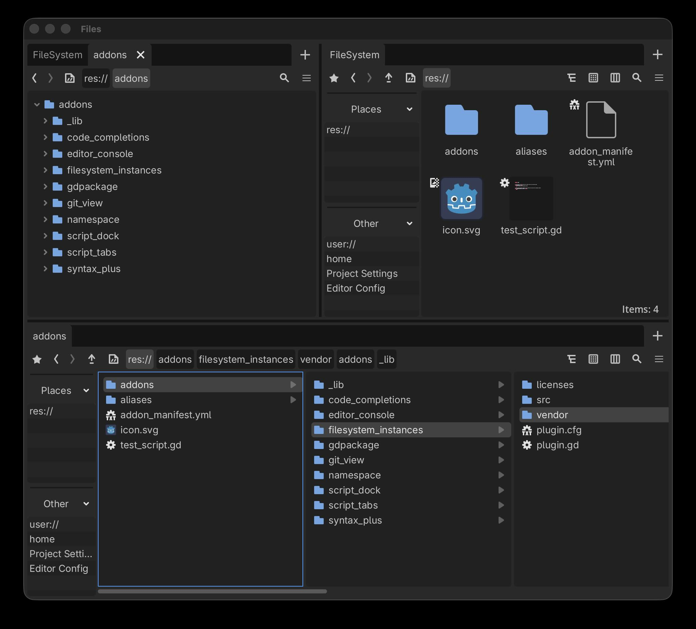

# FileSystem Instances

Godot 4.6+


This plugin adds file system docks you can instance and free. It drives the Editor's file system, which allows near-parity functionality.

The re-usable filesystem [library](https://github.com/brohd11/godot-editor-filesystem) is modular usable in other plugins too.

**Note**: The rename function of context menu is reliable on the modern theme only, due to a quirk with the UI focus system.
It is disabled using the legacy theme.

There are 3 view modes:
- Standard Tree
- Item List/Grid
- Columns

You can instance multiple windows, splits, tabs. Pin folders as the root of the tree.



**Other Features:**
- Layout/panels persist  between sessions
- Filter by file type
- Preview panel, displays text files, Control scenes, 3D Scenes and models
- Places/favorites side bar
- Item selected signal can be used with other plugins
- Panel system can host any scene or script

## Install

This plugin uses external dependencies packaged with [GDPackage](https://github.com/brohd11/godot-gdpackage.git),
download the latest package from releases, it includes the required dependencies.

The dependency repos can be found in the require key of [plugin.cfg](./plugin.cfg)

You can also use [gdaddon](https://github.com/brohd11/gdaddon) to manage the installation.
It is a TUI package/repo manager that can install and update addons for you.

In your project:
```sh
gdaddon install brohd11/godot-filesystem-instances/release
```